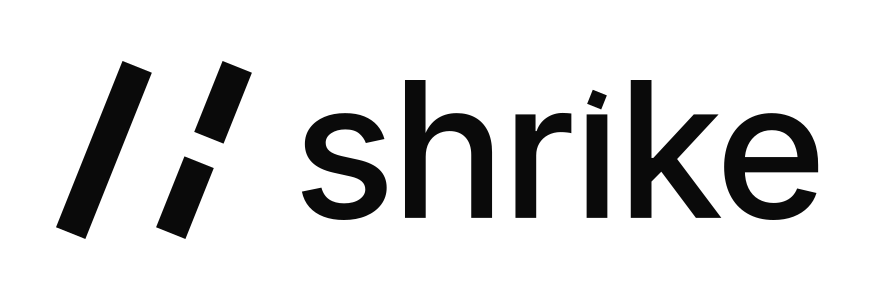

# Shrike brand assets

<picture>
  <source media="(prefers-color-scheme: dark)" srcset="shrike-logo-paper.svg">
  
</picture>

The Shrike mark is two parallel strokes leaning at 2:5. The left stroke runs
whole. The right stroke breaks exactly at its midpoint. One path survives; the
other is accounted for. It is drawn in one fill, so it inverts without a redraw.
The wordmark is lowercase Inter Medium with a custom i-dot turned to the same
lean.

**Direction:** The Break. Warm paper and near-black ink. No accent colour.

## Quick start

| Need | File |
| --- | --- |
| Logo on a light surface | [`shrike-logo.svg`](shrike-logo.svg) |
| Logo on a dark surface | [`shrike-logo-paper.svg`](shrike-logo-paper.svg) |
| Logo that carries its own dark background | [`shrike-logo-inverted.svg`](shrike-logo-inverted.svg) |
| Square avatar or social mark | [`shrike-symbol-inverted.svg`](shrike-symbol-inverted.svg) |
| Mark at 32 px or smaller | [`shrike-symbol-small.svg`](shrike-symbol-small.svg) |
| App icon | [`shrike-app-icon.svg`](shrike-app-icon.svg) or [`icon-512.png`](icon-512.png) |
| Browser tab | [`favicon.ico`](favicon.ico) or [`favicon.svg`](favicon.svg) |
| Social preview | [`og-card.png`](og-card.png) |

`-paper` files are paper-coloured artwork on transparency, for dark surfaces.
`-inverted` files carry a baked ink background, for cards, avatars, embeds, and
screenshots. The app icon is the exception: [`shrike-app-icon-inverted.svg`](shrike-app-icon-inverted.svg)
flips the tile to paper with an ink mark.

### HTML

```html
<picture>
  <source media="(prefers-color-scheme: dark)" srcset="/shrike-logo-paper.svg">
  
</picture>
```

The horizontal master is 880 × 300, so 440 × 150 is a half-scale rendering at
whole pixels. Keep the intrinsic ratio. Use `alt="Shrike"` when the logo stands
alone; use `alt=""` when the name is already next to it in text.

### Browser and install icons

[`head-snippet.html`](head-snippet.html) contains the complete set of icon tags.
[`site.webmanifest`](site.webmanifest) references the PWA icons at the site root.
If the site is served from a subpath, adjust the manifest `start_url` and icon
paths.

## The mark

The left stroke is the path that stays. The right stroke breaks at its midpoint:
the deletion is precise, central, and visible. The two halves of the right stroke
are equal, so the break reads as a measured cut, not an accident.

- **Lean.** Both strokes sit on the same 2:5 rise, 21.8° from vertical. The angle
  is rational, not sketched.
- **Break.** The 30-unit gap is centred on the right stroke. The two remaining
  pieces are 87 units each.
- **One fill.** Three shapes, one colour, no strokes. Inverting is a fill change.
- **No illustration.** There is no bird, feather, beak, or eye. The name is not
  drawn; the structure is.

### Geometry

| Property | Value |
| --- | --- |
| Canvas | 256 × 256 |
| Visible bounds | 16.4–239.6 × 26.6–229.4 |
| Stroke width | 36 |
| Stroke length | 204 |
| Lean | 2:5 (21.8° from vertical) |
| Break | 30, centred |
| Right pieces | 87 + 87 |
| Column offset | 114 |
| Wordmark | Inter Medium, 200 px master |
| i-dot | 16-unit square, turned to 21.8° |

The horizontal lockup is 880 × 300: a 178-high symbol, a 50 gap, and a 140-high
wordmark. The stacked lockup is 420 × 440. The wordmark master is 609 × 212
(544.85 × 147.76 visible).

## Clear space

Keep at least **1X** clear on every side, where **X** is the width of one bar:
36 units on the 256 canvas, or about 16% of the symbol’s width. At the full
horizontal lockup that is roughly 31.6 px. For the wordmark alone, use the width
of the i-dot as X. Type, rules, other marks, and the edge of a screen do not
enter this zone.

## Minimum sizes

| Asset | Digital | Print |
| --- | --- | --- |
| Horizontal lockup | 200 px wide | 45 mm wide |
| Stacked lockup | 140 px wide | 32 mm wide |
| Wordmark only | 120 px wide | 28 mm wide |
| Symbol | 24 px | 6 mm |
| Small symbol / favicon | 16 px | 5 mm |

The 16 px tab is the tightest case. Use [`shrike-symbol-small.svg`](shrike-symbol-small.svg)
or [`favicon.svg`](favicon.svg); the full symbol holds from 24 px up. The
favicon sets the mark on an ink rounded tile at 196/256, which keeps the break
open at 16 px.

## Colour

| Name | Value | RGB | Use |
| --- | --- | --- | --- |
| Shrike Ink | `#0A0A0A` | 10, 10, 10 | Artwork on paper |
| Shrike Paper | `#F7F5EF` | 247, 245, 239 | Reversed artwork, page ground |

The identity is ink and paper only. There are no tints, gradients, shadows, or
secondary brand colours. Ink on paper measures about 18:1 contrast; for
accessibility, use ink on paper or paper on ink. On a mid-tone, give the mark a
solid ink or paper plate.

For print, match ink to a rich neutral black and paper to the chosen stock; there
is no claimed Pantone match. Test a drawdown before committing a large run.

## Typography

- **Wordmark:** Inter Medium, 200 px master, tracking `-0.02 em`, dotless `ı`
  with a custom 16-unit square dot turned to 21.8°. Supplied as outlines; never
  retype it.
- **Supporting text:** Inter (or the system UI sans-serif stack). Sentence case.
- **Labels:** uppercase, `+0.16 em` tracking, as on the social card.

```css
font-family: Inter, ui-sans-serif, system-ui, -apple-system, "Segoe UI", sans-serif;
```

Inter is © The Inter Project Authors and licensed under the SIL Open Font
License 1.1. No font files are bundled with these assets; the wordmark is
already outlined.

## Do not

- Rotate, skew, stretch, or outline the mark.
- Change the lean: keep the 2:5 angle.
- Close the break, move it off centre, or make the right pieces unequal.
- Change the stroke width or the 114-unit column offset.
- Recolour, tint, fade, or add gradients, shadows, glows, or textures.
- Retype the wordmark or replace the custom i-dot.
- Rearrange the lockup or set the symbol inside another shape.
- Place the logo on busy imagery without a solid ink or paper plate.
- Add a bird, feather, or other illustration to the mark.

## Files

### Logo and symbol

| File | Size | Notes |
| --- | --- | --- |
| [`shrike-logo.svg`](shrike-logo.svg) | 880 × 300 | Primary horizontal lockup, ink on transparent |
| [`shrike-logo-paper.svg`](shrike-logo-paper.svg) | 880 × 300 | Horizontal lockup, paper on transparent |
| [`shrike-logo-inverted.svg`](shrike-logo-inverted.svg) | 880 × 300 | Horizontal lockup, paper on ink |
| [`shrike-logo-stacked.svg`](shrike-logo-stacked.svg) | 420 × 440 | Stacked lockup, ink on transparent |
| [`shrike-logo-stacked-paper.svg`](shrike-logo-stacked-paper.svg) | 420 × 440 | Stacked lockup, paper on transparent |
| [`shrike-logo-stacked-inverted.svg`](shrike-logo-stacked-inverted.svg) | 420 × 440 | Stacked lockup, paper on ink |
| [`shrike-wordmark.svg`](shrike-wordmark.svg) | 609 × 212 | Outlined wordmark, ink on transparent |
| [`shrike-wordmark-paper.svg`](shrike-wordmark-paper.svg) | 609 × 212 | Outlined wordmark, paper on transparent |
| [`shrike-wordmark-inverted.svg`](shrike-wordmark-inverted.svg) | 609 × 212 | Outlined wordmark, paper on ink |
| [`shrike-symbol.svg`](shrike-symbol.svg) | 256 × 256 | Full symbol, ink on transparent |
| [`shrike-symbol-paper.svg`](shrike-symbol-paper.svg) | 256 × 256 | Full symbol, paper on transparent |
| [`shrike-symbol-inverted.svg`](shrike-symbol-inverted.svg) | 512 × 512 | Full symbol, paper on a square ink field |
| [`shrike-symbol-small.svg`](shrike-symbol-small.svg) | 240 × 240 | Tight crop for tabs, ink on transparent |
| [`shrike-symbol-small-paper.svg`](shrike-symbol-small-paper.svg) | 240 × 240 | Tight crop for tabs, paper on transparent |

### Icons and social

| File | Size | Notes |
| --- | --- | --- |
| [`shrike-app-icon.svg`](shrike-app-icon.svg) | 512 × 512 | Paper mark on an ink rounded tile |
| [`shrike-app-icon-inverted.svg`](shrike-app-icon-inverted.svg) | 512 × 512 | Ink mark on a paper rounded tile |
| [`favicon.svg`](favicon.svg) | 256 × 256 | Ink rounded tile, paper mark at 196/256 |
| [`favicon.ico`](favicon.ico) | 16, 32, 48 | Multi-resolution favicon |
| [`favicon-16.png`](favicon-16.png) | 16 × 16 | PNG favicon |
| [`favicon-32.png`](favicon-32.png) | 32 × 32 | PNG favicon |
| [`favicon-48.png`](favicon-48.png) | 48 × 48 | PNG favicon |
| [`apple-touch-icon.png`](apple-touch-icon.png) | 180 × 180 | Full-bleed ink tile for iOS |
| [`icon-192.png`](icon-192.png) | 192 × 192 | PWA icon |
| [`icon-512.png`](icon-512.png) | 512 × 512 | PWA icon |
| [`maskable-512.png`](maskable-512.png) | 512 × 512 | Full-bleed maskable icon, safe-zone padding |
| [`og-card.svg`](og-card.svg) | 1200 × 630 | Social card, vector |
| [`og-card.png`](og-card.png) | 1200 × 630 | Social card, raster |

### Raster exports

These are transparent unless the filename says `inverted`.

| File | Width |
| --- | --- |
| [`png/shrike-logo-black.png`](png/shrike-logo-black.png) | 1600 |
| [`png/shrike-logo-paper.png`](png/shrike-logo-paper.png) | 1600 |
| [`png/shrike-logo-inverted.png`](png/shrike-logo-inverted.png) | 1600 |
| [`png/shrike-logo-stacked-black.png`](png/shrike-logo-stacked-black.png) | 1000 |
| [`png/shrike-logo-stacked-paper.png`](png/shrike-logo-stacked-paper.png) | 1000 |
| [`png/shrike-logo-stacked-inverted.png`](png/shrike-logo-stacked-inverted.png) | 1000 |
| [`png/shrike-symbol-black.png`](png/shrike-symbol-black.png) | 1024 |
| [`png/shrike-symbol-paper.png`](png/shrike-symbol-paper.png) | 1024 |
| [`png/shrike-symbol-inverted.png`](png/shrike-symbol-inverted.png) | 1024 |
| [`png/shrike-wordmark-black.png`](png/shrike-wordmark-black.png) | 1600 |
| [`png/shrike-wordmark-paper.png`](png/shrike-wordmark-paper.png) | 1600 |
| [`png/shrike-wordmark-inverted.png`](png/shrike-wordmark-inverted.png) | 1600 |
| [`png/shrike-app-icon.png`](png/shrike-app-icon.png) | 1024 |
| [`png/shrike-app-icon-inverted.png`](png/shrike-app-icon-inverted.png) | 1024 |

### Web files

| File | Notes |
| --- | --- |
| [`head-snippet.html`](head-snippet.html) | Icon, manifest, and theme-colour tags |
| [`site.webmanifest`](site.webmanifest) | PWA manifest |
| [`index.html`](index.html) | Visual brand page |
| [`brand-board.html`](brand-board.html) | Five-slide identity presentation, self-contained |
| [`brand-board.png`](brand-board.png) | Presentation board, raster |
| [`README.md`](README.md) | This guide |

## Licensing

These assets are part of the Shrike repository and are released under its MIT
licence (see [`../LICENSE`](../LICENSE)). Inter is © The Inter Project Authors,
licensed under the SIL Open Font License 1.1; the wordmark is outlined and no
font software is redistributed in this folder.

“Shrike” and the Shrike mark identify this project. Do not use them to imply
endorsement of an unrelated product.
